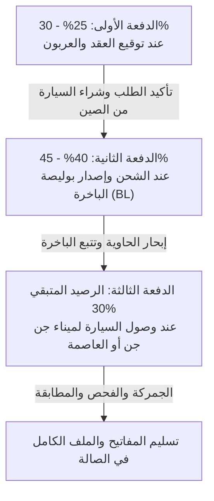

# 📊 دليل القوانين الجمركية، حساب التكاليف، وهندسة الدفعات المالية لـ CARVEX EXPORT
### المرجع الحسابي والتشغيلي لبرمجة الحاسبة التفاعلية ونظام إدارة المبيعات

---

## 📌 فهرس الدليل
1. **المرجعية القانونية الرسمية لاستيراد السيارات أقل من 3 سنوات في الجزائر**
2. **جدول نسب التخفيضات والقواعد الجمركية بحسب سعة ونوع المحرك**
3. **المعادلة الرياضية الدقيقة لحساب الحقوق والرسوم الجمركية (Droits et Taxes)**
4. **نظام رخص المجاهدين (Licence Moudjahidine) مقارنة بالنظام العادي**
5. **المصاريف الملحقة الثابتة في الموانئ الجزائرية (Frais Portuaires & Transit)**
6. **خوارزمية عمل الحاسبة التفاعلية المقترحة في الموقع (Calculator Logic)**
7. **هندسة الدفعات المالية وتوزيع الأموال (Financial Payment Milestones)**
8. **الأصول المتوفرة في المشروع (Logos, Phones, Showrooms & Assets)**

---

## 1. المرجعية القانونية الرسمية في الجزائر

تخضع عمليات استيراد السيارات المستعملة لأقل من ثلاث سنوات في الجزائر للنصوص التالية:
* **المرسوم التنفيذي رقم 23-74** (المؤرخ في 20 فبراير 2023): المحدد لشروط وكيفيات جمركة ومراقبة مطابقة السيارات السياحية والنفعية المستعملة المقتناة من طرف الأفراد المقيمين للاستعمال الشخصي.
* **قانون المالية 2023 (المادة 66) وقانون المالية 2024 / 2025 (المادة 110 المعدلة)**: التي أقرت تخفيضات جبائية كبرى لتشجيع السيارات الاقتصادية والصديقة للبيئة.

### الشروط الإلزامية التي يحددها القانون:
1. **عمر السيارة:** أقل أو يساوي **3 سنوات** بالتمام، محسوبة باليوم والشهر من تاريخ أول وضع في السير في الخارج إلى تاريخ التسجيل الجمركي بالجزائر.
2. **نوع الوقود المسموح:** محركات **بنزين (Essence)، كهربائية (Électrique)، أو هجينة (Hybride: بنزين + كهرباء)**.
3. **الممنوع قانوناً:** **يُمنع منعاً باتاً استيراد سيارات الديزل (المازوت)** للأفراد في إطار قانون أقل من 3 سنوات.
4. **دورية الاستيراد:** يحق لكل مواطن مقيم استيراد سيارة واحدة **مرة كل ثلاث سنوات**.

---

## 2. جدول نسب التخفيضات الرسمية للحقوق والرسوم

| فئة المحرك ونوع الوقود | نسبة التخفيض الجمركي بالقانون | الموديلات المطابقة لدى Carvex | الأثر الفعلي على السعر |
| :--- | :---: | :--- | :--- |
| **كهربائية 100% (Électrique)** | **80% تخفيض** من إجمالي الرسوم | سيارات الـ EV الصينية الحديثة | رسوم جمركية شبه رمزية (أقل من 10% من سعر السيارة). |
| **بنزين أو هجين $\le 1800\text{ cm}^3$ (1.8 لتر)** | **50% تخفيض** من إجمالي الرسوم | **Geely Coolray (1.5T), MG5 (1.5L), Chery Tiggo 4/7 (1.5T), Jetour Dashing (1.5T), Kia K3 (1.5L)** | **الفئة الأكثر مبيعاً (95% من واردات Carvex)**، رسومها مقبولة جداً للمستهلك. |
| **بنزين أو هجين $> 1800\text{ cm}^3$ (أكبر من 1.8 لتر)** | **20% تخفيض** فقط من إجمالي الرسوم | السيارات الرياضية ومحركات 2.0T أو V6 الكبيرة | رسوم مرتفعة جداً لوجود ضريبة الاستهلاك الداخلي (TIC). |

---

## 3. المعادلة الرياضية الدقيقة لحساب الجمركة العادية (بدون رخصة مجاهدين)

تُحسب الحقوق الجمركية على أساس القيمة الجمركية المقبولة للسيارة واصلة للميناء (**Valeur en Douane - CIF/CAF**):

$$\text{CAF} = \text{سعر شراء السيارة في الخارج} + \text{تكلفة الشحن البحري التأمين}$$

### أ. الرسوم الأساسية قبل التخفيض:
1. **الرسم الجمركي (Droit de Douane - DD):** 
   $$\text{DD} = 30\% \times \text{CAF}$$
2. **رسم المساهمة التضامنية (TCS):** 
   $$\text{TCS} = 2\% \times \text{CAF}$$
3. **الرسم على القيمة المضافة (TVA - 19%):** يُحسب على المبلغ الإجمالي (CAF + DD + TCS):
   $$\text{TVA} = 19\% \times (\text{CAF} + \text{DD} + \text{TCS}) = 19\% \times (1.32 \times \text{CAF}) \approx 25.08\% \times \text{CAF}$$

$$\text{مجموع الضرائب قبل التخفيض} = 30\% + 2\% + 25.08\% = \mathbf{57.08\%} \text{ من قيمة CAF}$$

### ب. الرسوم بعد تخفيض 50% (فئة سيارات Carvex ذات محركات 1.5 لتر):
$$\text{الرسوم الجمركية الصافية} = 57.08\% \times 0.50 \approx \mathbf{28.54\%} \text{ من قيمة CAF بالدينار}$$

*مثال عملي:*
* إذا كان سعر السيارة واصلة لميناء جن جن هو **200 مليون سنتيم** (قيمة CAF بالدينار وفق التسعير الجمركي):
* الرسوم الجمركية الصافية = $200 \times 28.54\% \approx \mathbf{57}$ **مليون سنتيم**.

---

## 4. نظام رخصة المجاهدين (Licence Moudjahidine)

رخصة المجاهدين هي الامتياز الأقوى والأكثر استخداماً في السوق الجزائري:

* **الإعفاء:** إعفاء كامل بنسبة **100%** من الرسم الجمركي (DD = 0%) والرسم على القيمة المضافة (TVA = 0%) للسيارات السياحية ذات محرك بنزين حتى سعة $2000\text{ cm}^3$.
* **ما يُدفع فعلياً للدولة:** 
  * رسوم طوابع جمركية وشكليات إدارية بسيطة (Quittance D10) لا تتعدى عادة **15,000 دج** (1.5 مليون سنتيم).
* **تكلفة الحصول على الرخصة (في حال عدم امتلاك الزبون لرخصة):**
  * سوق رخص المجاهدين التوثيقية بالجزائر يتراوح سعر كراء/شراء الرخصة حالياً بين **55 إلى 75 مليون سنتيم** (حسب وفرة الرخص وسعة المحرك).

---

## 5. المصاريف الملحقة الثابتة في الموانئ (Frais Portuaires & Logistiques)

هذه المصاريف يدفعها المستورد دائماً سواء بجمركة عادية أو برخصة مجاهدين:

1. **مصاريف الميناء والإنزال والشحن (Acconage, Dépotage & Manutention):**
   * ميناء جن جن (جيجل) أو ميناء الجزائر (EPAL): بين **45,000 إلى 70,000 دج** (4.5 إلى 7 ملايين سنتيم).
2. **أتعاب وكيل العبور الجمركي (Transitaire Agréé):**
   * بين **40,000 إلى 60,000 دج** (4 إلى 6 ملايين سنتيم).
3. **فحص المطابقة والمناجم وبطاقة العبور (Contrôle des Mines / Conformité DMI):**
   * بين **15,000 إلى 25,000 دج** (1.5 إلى 2.5 ملايين سنتيم).
4. **المجموع التقريبي للمصاريف الملحقة:** حوالي **100,000 إلى 155,000 دج** (**10 إلى 15.5 مليون سنتيم**).

---

## 6. خوارزمية عمل الحاسبة التفاعلية في الموقع (Interactive Calculator Logic)

لتقديم أرقام تقديرية دقيقة للزبون دون التورط بوعود تسعير خاطئة، نبرمج الحاسبة كالتالي:

```javascript
// خوارزمية تقدير تكلفة استيراد سيارة (بالدينار الجزائري سنتيم)
function calculateCarCost({ carFobPriceCentimes, engineDisplacementCc, isElectric, customsRegime }) {
  // carFobPriceCentimes: السعر الصافي واصل للميناء (FOB + Fret)
  let customsTaxPercentage = 0;
  let fixedPortAndTransitCentimes = 13; // 13 مليون سنتيم مصاريف ميناء وعبور
  let licenceCostCentimes = 0;

  if (customsRegime === "moudjahidine_with_license") {
    // الزبون يملك رخصة مجاهدين
    customsTaxPercentage = 0.01; // رسوم إدارية فقط
  } else if (customsRegime === "moudjahidine_need_license") {
    // الزبون يريد شراء رخصة مجاهدين عبر المعرض
    customsTaxPercentage = 0.01;
    licenceCostCentimes = 65; // متوسط سعر الرخصة بالسوق (65 مليون سنتيم)
  } else {
    // جمركة عادية (قانون أقل من 3 سنوات)
    if (isElectric) {
      customsTaxPercentage = 0.57 * 0.20; // تخفيض 80% = 11.4%
    } else if (engineDisplacementCc <= 1800) {
      customsTaxPercentage = 0.57 * 0.50; // تخفيض 50% = 28.5%
    } else {
      customsTaxPercentage = 0.57 * 0.80; // تخفيض 20% = 45.6%
    }
  }

  const estimatedCustomsTaxes = carFobPriceCentimes * customsTaxPercentage;
  const estimatedTotalCost = carFobPriceCentimes + estimatedCustomsTaxes + fixedPortAndTransitCentimes + licenceCostCentimes;

  return {
    fobCost: carFobPriceCentimes,
    customsTaxes: Math.round(estimatedCustomsTaxes),
    portTransit: fixedPortAndTransitCentimes,
    licenceCost: licenceCostCentimes,
    totalEstimated: Math.round(estimatedTotalCost)
  };
}
```

---

## 7. تدقيق مسألة الدفعات المالية وهندسة تقسيم الأموال (Payment Stages)

في تجارة السيارات بالجزائر، هناك نمطان ماليان يجب أن يتعامل معهما النظام والموقع:

### النمط الأول: بيع سيارة متوفرة في صالة العرض (Vente sur Stock)
1. **العربون (L'Arbon):** من **10% إلى 15%** (عادة بين 30 إلى 60 مليون سنتيم) يُدفع فوراً لحجز السيارة لمدة 48 إلى 72 ساعة.
   * يصدر له فوراً: `Reçu d'Arbon` رسمي يحمل رقم الهيكل التسلسلي (VIN) واسم الفرع.
2. **الرصيد المتبقي (Le Solde):** **85% إلى 90%** يُدفع عند توقيع العقد النهائي وتسليم المفاتيح والبطاقة الرمادية.

---

### النمط الثاني: الاستيراد بالطلب والشحن من الصين (Sur Commande)
هذا هو العصب التجاري لـ Carvex، وتوزيع الدفعات فيه مبني على **3 محطات أمان متتالية (3 Safety Milestones)**:



#### 1. الدفعة الأولى: العربون وتأكيد الشراء (Acompte Initial) — [25% إلى 30%]
* **القيمة:** حوالي ربع إلى ثلث السعر الإجمالي (مثلاً: 80 إلى 120 مليون سنتيم لسيارة سعرها 390 مليون).
* **الغرض التشغيلي:** تحويل العربون للمصدر في الصين، حجز المركبة بالمصنع، وتجهيز شهادة المنشأ والفحص الميكانيكي.
* **الوثائق الصادرة للزبون:**
  * وصل استلام عربون رسمي (`Reçu d'arbon`) مرقم ومختوم.
  * طلب شراء رسمي (`Bon de commande`) يحدد بدقة: الموديل، سنة الصنع، اللون، نوع المحرك، ومدة التسليم القصوى (عادة 45 إلى 65 يوماً).

#### 2. الدفعة الثانية: عند الشحن البحري وإصدار بوليصة الشحن (Au Chargement & B/L) — [40% إلى 45%]
* **القيمة:** تمثل القسط الأكبر لتغطية شحن الحاوية ورسوم التصدير الدولية.
* **محفز الأمان والشفافية (Trust Anchor):** Carvex لا تطلب هذه الدفعة إلا بعد تقديم دلائل مادية قاطعة:
  * صورة السيارة داخل الحاوية في ميناء الصين مع رقم الهيكل.
  * **نسخة رسمية من بوليصة الشحن البحري (Bill of Lading - B/L)** الصادرة عن خط الملاحة العالمي.
  * **رقم الحاوية (Container Number)** واسم السفينة، ليتسنى للمشتري تتبع السفينة مباشرة عبر الموقع!

#### 3. الدفعة الثالثة: عند وصول السفينة إلى الميناء الجزائري والتسليم (À la Livraison) — [الرصيد المتبقي: 25% إلى 35%]
* **التوقيت:** رسو الباخرة في ميناء جن جن (جيجل) أو ميناء الجزائر العاصمة وتفريغ الحاويات.
* **الغرض التشغيلي:** تغطية الرسوم الجمركية المتبقية، حقوق الميناء، الفحص التقني للمناجم، ونقل السيارة على شاحنة النقل (Porte-char) إلى الصالة المختارة (العاصمة، جيجل، أو ورقلة).
* **المخرجات والتسليم:**
  * فحص الزبون للسيارة والتأكد من خلوها من أي خدوش أو أضرار شحن.
  * تسليم مفاتيح السيارة والملف القاعدي الكامل:
    * وصل إبراء الجمارك الرسمي (`Quittance D10`).
    * شهادة المطابقة التقنية (`Certificat de conformité`).
    * البطاقة الرمادية المؤقتة أو ملف الترقيم الكامل.
  * تسليم وصل مخالصة نهائية (`Reçu de Solde`).

---

## 8. الأصول والبيانات المتوفرة للعميل (Carvex Assets Dossier)

تم استخراج وحفظ أصول وهوية Carvex الرسمية من ملفاتهم في المسار:
`d:\Jondi\Biz\Webos Mebos\Projects\Dealerships\Carvex Exports\assets`

* **شعار الشركة (Logo):** أيقونة سيارة انسيابية باللون الأزرق الفيروزي (Cyan) مع كلمة `CARVEX` بالخط العريض، وسلوجان رسمي:
  * *الانجليزية:* `YOUR GLOBAL AUTO PARTNER`
  * *العربية:* `شريكك العالمي للسيارات`
* **الفروع وأرقام الهواتف الرسمية الموثقة من منشوراتهم:**
  * 🏢 **الإدارة العامة:** `0770727007`
  * 📍 **صالة الجزائر العاصمة (المحمدية):** `0779055489` / `0557053814`
  * 📍 **صالة جيجل (بوالرمل):** `0660656274` / `0554154163`
  * 📍 **صالة ورقلة:** `0660414034` / `0661466727`
* **نماذج لأسعار حقيقية يبيعون بها حالياً (شاملة كل المصاريف 2026 - صفر كلم أقل من 3 سنوات):**
  * `Geely Coolray Manuelle`: **307 مليون سنتيم**.
  * `Geely Coolray Full`: **388 مليون سنتيم**.
  * `Geely Coolray Battle`: **399 مليون سنتيم**.
  * `MG5 Global (MX)`: **268 مليون سنتيم**.
