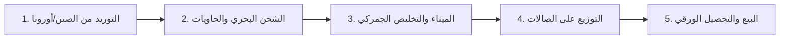

# 🚗 دليل عمليات استيراد السيارات في الجزائر ونقاط ألم Carvex
### الدليل الشامل لفهم آلية عمل المستورد، مشاكله اليومية، والحلول التقنية والتسويقية لبيع خدماتنا

---

## 📌 فهرس المحتويات
1. **الإجابة الاستراتيجية: هل نُظهر السعر النهائي في الموقع أم نُخفيه لإجبارهم على التواصل؟**
2. **كيف يعمل مستورد وبائع السيارات في الجزائر؟ (دورة العمليات من الصين إلى المفتاح)**
3. **تشريح نقاط الألم اليومية (Pain Points) التي يعاني منها Carvex**
4. **ماذا يمكننا أن نبيعهم ونبنيه لهم؟ (Our Agency Solution Stack)**
   * أ. الموقع وتطبيقات الويب (Web App & Showcase)
   * ب. أنظمة الأتمتة والـ CRM (ManyChat / WhatsApp / Telegram Bots)
   * ج. السكريبتات، صناعة المحتوى والإعلانات الممولة (Meta Ads Strategy)
5. **تحليل أداة `Showroom213` وكيف نستفيد منها كمرجع وظيفي**

---

## 1. الإجابة الاستراتيجية: هل نُظهر السعر النهائي أم نُخفيه؟

> **سؤالك الجوهري:** *"أليس الأحكم أن لا نريهم السعر النهائي لكي نجبرهم على التعامل والتواصل معنا؟"*

هذا السؤال هو **أكبر معضلة يقع فيها تجار السيارات في الجزائر**، والإجابة الدقيقة تعتمد على فهم عقلية المشتري الجزائري وطبيعة تجارة استيراد السيارات.

### أ. لماذا تلجأ الشركات لإخفاء السعر ("السعر في الخاص / PV")؟
1. **الخوف من المنافسين:** يخشى التاجر أن يرى منافسه السعر فيخفض عنه بـ 5 أو 10 ملايين سنتيم.
2. **تقلب أسعار الصرف:** العملة (سعر الصرف في السكوار مقابل اليوان الصيني أو اليورو) والرسوم البحرية تتغير دورياً.
3. **تعدد الحالات الجمركية:** سعر السيارة ليس واحداً؛ سعرها برخصة مجاهدين يختلف جذرياً عن سعرها بدون رخصة (استيراد عادي للمواطنين بملف أقل من 3 سنوات).
4. **الرغبة في اصطياد الليد (Lead Capture):** إجبار العميل على إرسال رسالة أو الاتصال.

### ب. الكارثة التي تسببها سياسة "السعر في الخاص" (لماذا تفشل في التحويل؟):
1. **تدمير الثقة:** المشتري الجزائري أصبح ينفر بشدة من صفحات "السعر في الخاص" ويعتبرها دليلاً على عدم الشفافية أو التلاعب بالأسعار حسب مظهر الزبون.
2. **إرهاق فريق المبيعات والقتل البطيء للوقت (Tire-Kickers Fatigue):**
   * إذا أخفيت السعر، ستتلقى **500 رسالة يومياً** تسأل فقط: *"شحال السعر؟"*.
   * 90% منهم ميزانيتهم 180 مليون سنتيم، والسيارة سعرها 450 مليون! 
   * النتيجة: الموظف يضيع 8 ساعات يومياً في نسخ ولصق الأسعار لأشخاص غير مؤهلين، بينما يضيع الزبون الجاد (الذي يملك 500 مليون كاش) وسط زحام الرسائل التافهة!

### ج. الحل الاحترافي الرابح: "الشفافية المشروطة" (The Hybrid Pricing Engine)
بدلاً من إخفاء السعر تماماً أو كشف كل التفاصيل مجاناً، نطبق المعادلة الذهبية:

```
[إظهار السعر المرجعي / ابتداءً من] + [حاسبة تكاليف تفاعلية] = [حجز عرض السعر النهائي الدقيق عبر واتساب]
```

1. **إظهار السعر الأساسي الصافي واصل للميناء (FOB + Fret):**
   * نكتب بوضوح: *"ابتداءً من: [X] مليون سنتيم (تشمل سعر السيارة والشحن المؤمّن إلى ميناء جن جن / الجزائر)"*.
   * هذا يفرز الزبائن فوراً؛ من لا يملك هذه الميزانية ينسحب بهدوء دون إضاعة وقتك.
2. **أداة حاسبة الجمارك التقديرية (Calculator as a Lead Magnet):**
   * يدخل العميل ويختار:
     * نوع الشراء: *(برخصة مجاهدين) أم (بدون رخصة - قانون أقل من 3 سنوات)*.
     * الصالة المفضلة للاستلام: *(العاصمة، جيجل، ورقلة)*.
   * تعطيه الحاسبة رقماً تقديرياً.
3. **قفل عرض السعر الدقيق (Gating the Final Devis):**
   * للحصول على جدول التكاليف التفصيلي وموعد الباخرة القادمة وتثبيت السعر:
   * يضغط العميل: **«احصل على العرض الرسمي عبر واتساب»**.
   * هنا يصل لفريق المبيعات ليد جاهز ومؤهل: يعرف السيارة، يعرف ميزانيتها التقريبية، ولديه رغبة حقيقية في الشراء!

---

## 2. كيف يعمل مستورد وبائع السيارات في الجزائر؟ (Operations Blueprint)

لفهم إشكالاتهم، يجب أن نعرف كيف تدور عجلات تجارتهم يوماً بيوم:



### المرحلة 1: التوريد والتعاقد في الخارج (Sourcing)
* يتواصل المستورد مع مصانع أو وكلاء تصدير في الصين (مثل تشانغان، جيلي، شيري، جيتور).
* يحصل على قائمة الأسعار ومواصفات الدفعات (Lots).
* يقوم بدفع العربون للمورد عبر تحويل بنكي دولي أو مكاتب وساطة مالية.

### المرحلة 2: الشحن البحري (Logistics & Containers)
* حجز الحاويات (Containers) مع شركات الملاحة العالمية (CMA CGM, Maersk, COSCO).
* تحميل السيارات وتوثيق أرقام الهياكل (Châssis / VIN).
* إصدار بوليصة الشحن البحرية الرسمية (**Bill of Lading / Connaissement**).
* تستغرق الرحلة البحرية من موانئ الصين (شنغهاي، نينغبو) إلى الجزائر بين **45 إلى 65 يوماً**.

### المرحلة 3: الوصول والتخليص الجمركي (Customs & Transit)
* وصول الباخرة إلى ميناء الجزائر، ميناء جن جن (جيجل)، أو مستغانم.
* إفراغ الحاويات في الميناء الجاف (Zone sous douane).
* بدء مرحلة الدفع الجمركي (Dédouanement):
  * **الملف العادي (قانون -3 سنوات):** دفع الرسوم الجمركية، الرسم على القيمة المضافة (TVA)، وضريبة الاستهلاك الداخلي (TIC).
  * **ملف رخصة المجاهدين:** إعفاءات ضريبية معقدة تتطلب مطابقة رخصة المجاهد مع المشتري والتصديق عليها.

### المرحلة 4: الصالات وإدارة الفروع (Showrooms & Multi-branches)
* نقل السيارات على شاحنات (Porte-chars) إلى صالات Carvex الثلاث:
  * **الجزائر العاصمة (المحمدية):** الواجهة الرئيسية لأصحاب المعاملات السريعة.
  * **جيجل (بوالرمل):** قريبة من ميناء جن جن وتستقبل الشحنات البحرية مباشرة.
  * **ورقلة:** صالة موجهة لزبائن الجنوب والشركات البترولية ورجال الأعمال المحليين.
* تصنيف السيارات إلى 3 حالات:
  1. **En Stock (متوفرة للتسليم الفوري).**
  2. **Sur Commande (في الحاوية أو في مرحلة الطلب).**
  3. **Réservée (دفع صاحبها عربون وتنتظر استكمال الإجراءات).**

### المرحلة 5: البيع، التحصيل المالي وإصدار البطاقات
* كتابة عقد البيع (Contrat de vente / Bon de commande).
* تحصيل الدفعات:
  * دفعة 1: عربون عند توقيع العقد.
  * دفعة 2: عند وصول الحاوية للميناء.
  * دفعة 3: الرصيد المتبقي عند استلام السيارة والمفاتيح.
* تسليم ملف السيارة الكامل: بطاقة العبور الجمركية (D10 / Quittance)، البطاقة الرمادية المؤقتة أو شهادة المطابقة (Certificat de conformité).

---

## 3. تشريح نقاط الألم (Pain Points) الحقيقية لدى Carvex

من واقع أرقامهم وحساباتهم (وحسب ما كشفته منصة `Showroom213` كمعاناة عامة للمستوردين في الجزائر):

| نقطة الألم (The Problem) | الواقع الحالي لدى Carvex | الأثر التجاري والمالي |
| :--- | :--- | :--- |
| **1. فوضى المحادثات والـ CRM المفقود** | الزبائن يتواصلون عبر 5 أرقام هواتف، إنستغرام، تيك توك وفيسبوك دون مركزية. | نسيان مواعيد الاتصال، ضياع زبائن جادين، وعدم وجود متابعة (Follow-up) بعد الاستفسار الأول. |
| **2. انعدام الشفافية في تتبع السيارات (The Black Box)** | الزبون الذي دفع 400 مليون سنتيم يتصل كل يومين: *"وين راهي سيارتي؟"* | توتر وقلق هائل لدى العميل، وإشغال الموظفين بالرد المتكرر بدلاً من البيع. |
| **3. الموقع المعطل والهوية الضعيفة** | موقعهم مغلق أو قالب سيء، وشعارهم بدائي جداً. | المشتري الجزائري يشكك في مصداقيتهم، خاصة في قطاع يعاني من مخاوف النصب والاحتيال. |
| **4. إرهاق إرسال المواصفات المتكررة** | لكل زبون: الموظف يبحث في المعرض عن 15 صورة ويكتب المحرك وعلبة السرعة يدوياً في كل شات! | هدر ما لا يقل عن 3 إلى 4 ساعات عمل يومياً لكل موظف مبيعات. |
| **5. التنسيق بين الصالات الثلاث (Multi-branches)** | صالة العاصمة لا تعلم فوراً ما إذا كانت السيارة بيعت في جيجل أو ورقلة إلا بعد اتصالات هاتفية. | خطر بيع نفس السيارة لزبونين، أو تأخر إخبار العميل بتوفر سيارة في فرع آخر. |
| **6. احتراق خوارزميات إنستغرام (Dead Reach)** | 973 منشوراً لـ 2,000 متابع فقط (صفر Reach حقيقي)! | إهدار مجهود النشر اليومي دون جلب عملاء جدد بسبب غياب استراتيجية محتوى واضحة وسيو الفيديو. |

---

## 4. ماذا سنبيع لهم؟ (Our Complete Solution Stack)

بناءً على قدراتنا في (المواقع، الويب آب، الأوتوميشن، السكريبتات والإعلانات)، إليك حزمة الخدمات التي نستطيع تقديمها وتفصيلها لهم:

### أ. الموقع وتطبيق الويب (Custom Showcase & Web App)
1. **كتالوج ديناميكي متجاوب (Live Inventory):**
   * فلترة حسب: الماركة (Geely, Jetour, Chery...)، الميزانية، الحالة (تسليم فوري في المعرض / بالطلب من الصين).
   * فلترة حسب الصالة (العاصمة، جيجل، ورقلة).
2. **صفحة كل سيارة بنقرة زر (One-Click PDF & WhatsApp):**
   * إمكانية تصدير **ورقة مواصفات رسمية احترافية (Fiche Technique PDF)** تحمل لوغو Carvex وتفاصيل السيارة، يرسلها البائع للعميل بضغطة زر.
   * زر: *"احجز موعد معاينة في صالة [العاصمة/جيجل/ورقلة]"*.
3. **حاسبة استيراد تفاعلية (Smart Customs & Import Calculator):**
   * يختار الزبون الموديل ونوع الملف (مجاهدين / عادي)، فتعطيه تقديراً فورياً وتنقله لواتساب المبيعات لاستلام Devis رسمي.
4. **نظام تتبع الطلب (Order Tracking Page):**
   * صفحة يدخل فيها الزبون رقم طلبه أو رقم الشاسيه ليرى المرحلة الحالية:
     * 🟢 تم تأكيد الطلب بالعقد ➔ 🟢 الحاوية في البحر (مع اسم الباخرة) ➔ 🟡 وصول الميناء والتخليص ➔ ⚪ جاهزة للاستلام بالصالة.
   * *(هذه الميزة وحدها كفيلة بإغلاق الصفقة لأنها تمنحهم هيبة الشركات العالمية).*

### ب. حلول الأتمتة والـ CRM (Automation & Bot Infrastructure)
1. **أتمتة إنستغرام وتيك توك (Instagram & ManyChat Funnel):**
   * تماماً مثل ما شاهدناه في سكرين شوت `Showroom213`:
   * عندما يعلق شخص بـ "السعر" أو "مهتم"، يصله الرد التلقائي في الخاص:
     > *"أهلاً بك في Carvex Export 🚗.. هل تبحث عن سيارة متوفرة للتسليم الفوري في صالاتنا، أم تريد استيرادها بالطلب من الصين؟"*
   * توجيهه تلقائياً بحسب اختياره وإرسال رابط السيارة في الموقع مباشرة مع زر التحدث مع مستشار الفرع الأقرب إليه.
2. **أتمتة تنبيهات المبيعات عبر تيليغرام/واتساب (Internal Lead Alerts):**
   * عندما يطلب زبون Devis على الموقع لسيارة في فرع ورقلة، يصل إشعار فوري لمسؤول فرع ورقلة على تيليغرام:
     > *"🔔 ليد جديد: كمال من ورقلة مهتم بـ Jetour Dashing - رقم الهاتف: 06XXXXXXXX - نوع الطلب: رخصة مجاهدين"*.

### ج. صناعة المحتوى، السكريبتات، والإعلانات (Content & Ads Engine)
1. **إنقاذ الحساب وإعادة إحيائه (Account Revival Strategy):**
   * التوقف فوراً عن النشر العشوائي للصور الصامتة في المواقف.
   * تصميم قالب هوية بصرية جديد للبوستات: غلاف موحد للفيديوهات (Covers)، بنرات الصالات، وهايلايتس احترافية:
     * 📁 `آراء زبائننا` (تسليم مفاتيح).
     * 📁 `مسار الشحن` (فيديوهات تحميل الحاويات من الصين).
     * 📁 `صالاتنا` (العاصمة، جيجل، ورقلة).
     * 📁 `الأسئلة الشائعة` (ملف المجاهدين، مدة الشحن، شروط الدفع).
2. **سكريبتات الفيديو الجذابة (Hooks & Video Scripts):**
   * سكريبتات فيديو يصورها فريقهم في الصالة أو موظف المبيعات، مبنية على سيكولوجية كسر الشكوك:
     * *سكريبت 1:* "كيفاش تجيب سيارة زيرو كيلومتر من الصين للجزائر بلا ما تخاف على دراهمك؟ الخطوات خطوة بخطوة."
     * *سكريبت 2:* "شحال الفرق بين تشري سيارة من الصالة حاضرة، ولا تطلبها وتستنى شهرين؟ دراسة جدوى حقيقية."
     * *سكريبت 3:* "كفاش تحسب جمركة سيارتك برخصة المجاهدين؟ أسرار يوفرها عليك Carvex."
3. **هيكلة حملات فيسبوك وإنستغرام الممولة (Meta Ads):**
   * إعلانات Lead Generation بنظام الرسائل المؤتمتة لاستهداف الفئات الجادة (رجال الأعمال، المغتربين، موظفي الشركات الكبرى).

---

## 5. تحليل استئناس بأداة `Showroom213` (SaaS Benchmark)

الصور المرفقة من `showroom213.com` تعطينا نظرة داخلية مذهلة على كيفية تفكير رواد الأعمال في هذا المجال بالجزائر:

```
[Showroom213 Screen 1: Dashboard]
- مراقبة الأرباح الشهرية (Profit Mensuel)
- تذكيرات الاتصال اليومية للزبائن (Rappels à faire)
- توزيع حالات الطلبات (En attente, Confirmée, Terminée)
- إدارة الفروع ومصاريفها (Succursales)

[Showroom213 Screen 2: Stock Management]
- حالة السيارات: متوفرة (59)، محجوزة (9)، مباعة (26)
- حساب قيمة المخزون الكلي بالدينار
- تفاصيل كل سيارة: الوضع الجمركي (Douane & Papiers)، فحص الهيكل، وإمكانية إخراج بطاقة PDF فنية

[Showroom213 Screen 3: Automated DM Chatbot]
- المحادثة التفاعلية الذكية: تصنيف العميل فورياً (هل تستورد؟ هل تبيع من الستوك؟ أم كلاهما؟)
```

### كيف نستغل هذا في حديثنا مع Carvex؟
* نثبت لهم أننا نفهم بيئة عملهم من الداخل: مصطلحاتهم (Conteneurs, Dédouanement, Coût de revient, Multi-branches, Licence).
* نوضح لهم أن موقعهم ليس مجرد "صفحة ديكور"، بل هو **نظام مبيعات يربط الصالات الثلاث، يصفي الزبائن الجادين، ويجعل المستشار التجاري يغلق الصفقات بدلاً من كتابة الأسعار يدوياً كل دقيقة**.
