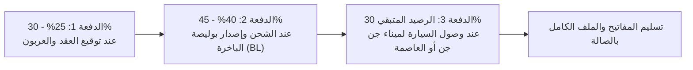

# 📘 وثيقة متطلبات المنتج الشاملة (Master PRD)
# CARVEX EXPORT — المنصة الرقمية ونظام إدارة المبيعات والاستيراد

---

## 📌 فهرس الوثيقة الشاملة
1. **بطاقة المشروع وهوية العميل (Client Dossier & Identity)**
2. **الفروع الفعلية، أرقام الاتصال، والشبكات الاجتماعية**
3. **الأهداف الاستراتيجية ونموذج العمل (Business & Strategic Objectives)**
4. **البنية التحتية والتقنية المعتمدة (Tech Stack & Architecture)**
5. **استراتيجية حسابات المستخدمين (User Accounts Strategy)**
6. **مخطط قاعدة البيانات ومجموعات PocketBase (Collections Schema)**
7. **المواصفات الوظيفية للواجهة العامة للموقع (Public Web App Specs)**
8. **محرك الحسابات الجمركية (Algerian Customs & Cost Engine)**
9. **هندسة الدفعات المالية ومسار الشحن (Payment Tranches & Shipping Milestones)**
10. **محرك الوثائق وتوليد المستندات الرسمية (Document Generation Engine)**
11. **نظام الإشعارات والأتمتة (Telegram Sales Bot & WhatsApp Routing)**
12. **التصميم، الألوان، والأصول المتوفرة (Design System & Assets)**
13. **قائمة النواقص ومتطلبات الإطلاق (Checklist: Anything Else?)**
14. **خارطة الطريق ومراحل التنفيذ (Milestones & Roadmap)**

---

## 1. بطاقة المشروع وهوية العميل (Client Dossier & Identity)

* **اسم النشاط الرسمي:** CARVEX EXPORT (كاركس إكسبورت).
* **الشعار اللفظي (Slogan):**
  * *الانجليزية:* `YOUR GLOBAL AUTO PARTNER`
  * *العربية:* `شريكك العالمي للسيارات`
* **مجال النشاط التجاري:** 
  * استيراد، شحن بحري، وتوزيع السيارات الجديدة والمستعملة (أقل من 3 سنوات / صفر كيلومتر) مباشرة من الصين، أوروبا، وكوريا الجنوبية إلى السوق الجزائري.
  * البيع المباشر من الصالات للسيارات الحاضرة (Sur Stock).
  * الاستيراد بالطلب لصالح الأفراد مع مرافقة التخليص الجمركي (Sur Commande).
* **الموقع الرسمي المراد تطويره:** `https://carvexexport.com/` (الموقع السابق معطل/مغلق).
* **ملف الشعار الرسمي:** متوفر بدقة عالية في مسار المشروع:
  `d:\Jondi\Biz\Webos Mebos\Projects\Dealerships\Carvex Exports\assets\carvex_logo_official.jpg`

---

## 2. الفروع الفعلية، أرقام الاتصال، والشبكات الاجتماعية

تم حصر وتوثيق كافة عناوين الفروع وأرقام الهواتف الرسمية للشركة:

| الجهة / الفرع | العنوان الميداني | أرقام الهواتف الرسمية | الدور التشغيلي |
| :--- | :--- | :--- | :--- |
| **🏢 الإدارة العامة (Siège Central)** | الجزائر العاصمة | `0770727007` | الإدارة، إبرام العقود الكبرى، والوساطة المالية الدولية. |
| **📍 صالة الجزائر العاصمة** | المحمدية / الصنوبر البحري (Mohammadia / Pins Maritimes) | `0779055489`<br>`0557053814` | صالة المعاينة المركزية واستقبال زبائن الوسط والغرب. |
| **📍 صالة جيجل** | بوالرمل (Boulrimal, Jijel) | `0660656274`<br>`0554154163` | نقطة الاستقبال والتخزين الأولى لقربها من **ميناء جن جن**. |
| **📍 صالة ورقلة** | وسط المدينة / حي النصر | `0660414034`<br>`0661466727` | تلبية طلبات زبائن الجنوب ورجال الأعمال وموظفي قطاع الطاقة. |

### الروابط والمنصات الرقمية الموثقة:
* **رابط واتساب الإدارة المباشر:** `https://wa.me/213770727007`
* **منصة Linktree:** `https://linktr.ee/carvexexport`
* **صفحة فيسبوك:** `https://www.facebook.com/Carvexexport/`
* **حساب إنستغرام:** `https://www.instagram.com/carvexexport/` (973+ بوست / ~2,030 متابع)
* **قناة تيك توك:** `https://www.tiktok.com/@carvex.export`
* **قناة يوتيوب:** `https://www.youtube.com/@Carvex.export`

---

## 3. الأهداف الاستراتيجية ونموذج العمل (Business Objectives)

1. **معالجة فجوة الثقة (Bridging the Trust Gap):**
   * زبون السيارات يدفع بين 250 إلى 600 مليون سنتيم؛ الموقع الجديد يبني مصداقية حديدية تجعل Carvex تظهر كوكيل رسمي وليس مجرد مساحات تخزين عشوائية.
2. **إنهاء إرهاق فريق المبيعات (Eliminating Tire-Kickers):**
   * إيقاف إرسال الصور يدوياً والرد على 500 استفسار عشوائي عبر حاسبة التكاليف التفاعلية وبطاقة السيارة الـ PDF بنقرة واحدة.
3. **الشفافية في مسار الحاويات (De-risking the Black Box):**
   * تمكين المشتري من متابعة مكان سيارته وحاويته في البحر دون الحاجة للاتصال المتكرر بالمعرض.
4. **توجيه الزبون للفرع المناسب بحرية تامة:**
   * منح الزبون خيار التواصل المباشر مع فرع ولايته الأقرب (العاصمة، جيجل، ورقلة، أو الإدارة).

---

## 4. البنية التحتية والتقنية المعتمدة (Tech Stack)

```
[ Frontend: Next.js 15 (App Router) + Tailwind CSS + shadcn/ui ]
                    │
                    ▼  (REST API + Realtime WebSockets)
[ Backend: PocketBase (Go/SQLite) on VPS Server ]
                    │
                    ▼  (S3-Compatible Protocol)
[ Storage: Cloudflare R2 (Zero-Egress Object Storage) ]
                    │
                    ▼
[ Output: Fast Web Showcase + Telegram Bot Alerts + On-the-fly PDFs ]
```

* **الواجهة الأمامية (Frontend):**
  * **Next.js 15 (App Router)** مع **Tailwind CSS** و **shadcn/ui**.
  * تقديم تجربة استثنائية وسريعة جداً على الهواتف مع دعم التبديل السلس للغة (العربية والفرنسية).
  * أرشفة محركات البحث الفائقة (SEO) لتصدر كلمات مثل: *"سعر Geely Coolray بالدينار في الجزائر"* أو *"استيراد سيارات الصين رخصة مجاهدين"*.
* **الواجهة الخلفية (Backend & Database):**
  * **PocketBase:** يعمل كملف تنفيذي مدمج وسريع على سيرفر VPS، يدير قاعدة البيانات ونظام المصادقة والصلاحيات (RBAC).
* **تخزين الوسائط (Media Storage):**
  * **Cloudflare R2:** متصل مع PocketBase لتخزين صور السيارات عالية الدقة، الوثائق، والـ PDFs مع **صفر تكلفة تدفق بيانات (Zero Egress Fees)** و CDN عالمي فائق السرعة.
* **نظام التنبيهات والأتمتة:**
  * **Telegram Sales Bot:** إرسال إشعارات فورية لمجموعات مبيعات الفروع عند تسجيل ليد جديد أو استخدام حاسبة الجمارك.

---

## 5. استراتيجية حسابات المستخدمين (User Accounts Strategy)

* **الزبائن والجمهور العام (No Sign-Up Required):**
  * **لا نطلب من الزبون إطلاقاً إنشاء حساب بكلمة مرور أو بريد إلكتروني.**
  * شراء السيارات يتم مرة كل عدة سنوات؛ إلزام الزبون بالتسجيل يقتل نسبة التحويل بنسبة تفوق 50%.
  * **نظام التتبع السلس:** يتابع الزبون سيارته عبر: **رقم الهاتف + رقم الطلب / رمز الأمان السري (Magic PIN)**.
* **حسابات فريق العمل والإدارة (Staff Only via PocketBase):**
  * حسابات محمية بصلاحيات دقيقة:
    1. `admin`: الإدارة العامة (وصول كامل لكافة العمليات والتقارير المالية).
    2. `agent_alger`: مسؤول صالة العاصمة (إدارة سيارات وليدات فرع العاصمة).
    3. `agent_jijel`: مسؤول صالة جيجل.
    4. `agent_ouergla`: مسؤول صالة ورقلة.

---

## 6. مخطط قاعدة البيانات ومجموعات PocketBase (Collections Schema)

### 1. مجموعة الفروع (`branches`)
* `id` (نصي فريد)
* `code` (`alger`, `jijel`, `ouergla`)
* `name_ar` (الجزائر العاصمة - المحمدية / جيجل - بوالرمل / ورقلة - وسط المدينة)
* `name_fr` (Alger - Mohammadia / Jijel - Boulrimal / Ouargla)
* `phone_commercial_1` (مثلاً: `0779055489`)
* `phone_commercial_2` (مثلاً: `0557053814`)
* `phone_whatsapp` (مثلاً: `213779055489`)
* `address_text` (العنوان النصي)
* `google_maps_url` (رابط الخريطة)
* `is_active` (منطقي: true)

### 2. مجموعة السيارات (`vehicles`)
* `id`
* `title` (مثال: Geely Coolray Full 2026)
* `brand` (Geely, Jetour, Chery, MG, Livan, Kia, Audi...)
* `model` (Coolray, Dashing, Tiggo 7, MG5...)
* `year` (2024, 2025, 2026)
* `mileage_status` (`zero_km` صفر كلم / `used_less_than_3_years` أقل من 3 سنوات)
* `origin_country` (`China`, `Europe`, `South Korea`)
* `status`:
  * `in_stock` (حاضرة بالصالة للتسليم الفوري)
  * `in_transit` (في الحاوية / الباخرة)
  * `on_order` (بالطلب من المصنع بالصين)
  * `reserved` (تم دفع عربونها)
  * `sold` (مباعة)
* `branch` (علاقة اختيارية مع `branches` لتحديد الصالة المتواجدة بها)
* `price_total_dzd_centimes` (السعر الإجمالي شامل المصاريف بالسنتيم: مثلاً `388` لـ 388 مليون سنتيم)
* `price_fob_dzd_centimes` (السعر الصافي واصل للميناء بدون جمارك)
* `engine_type` (`essence`, `hybrid`, `electric`)
* `engine_displacement_cc` (سعة المحرك بالسم مكعب: مثلاً `1498` لموديل 1.5L)
* `transmission` (`automatique`, `manuelle`)
* `color` (أبيض، رمادي، أسود، أحمر...)
* `images` (مصفوفة صور كلاسيكية متعددة الزوايا على Cloudflare R2)
* `spec_sheet_pdf` (رابط ملف PDF التقني)
* `is_featured` (منطقي - لتثبيتها في واجهة الموقع الرئيسية)

### 3. مجموعة الشحنات البحرية والحاويات (`shipments`)
* `id`
* `container_number` (مثلاً: `MSKU9023412`)
* `shipping_company` (`COSCO`, `CMA CGM`, `Maersk`, `MSC`)
* `vessel_name` (اسم السفينة الناقلة)
* `departure_port` (شنغهاي، نينغبو...)
* `arrival_port` (ميناء جن جن بجيجل / ميناء الجزائر)
* `departure_date` (تاريخ الإبحار)
* `estimated_arrival` (تاريخ الوصول المتوقع)
* `current_status` (`loaded_china`, `sailing`, `arrived_port`, `cleared`)

### 4. مجموعة الطلبات وتتبع الزبائن (`orders`)
* `id`
* `order_number` (رقم الطلب التسلسلي: مثلاً `CRX-26-0142`)
* `client_name` (اسم الزبون)
* `client_phone` (رقم الهاتف)
* `client_pin` (رمز سري من 4 أرقام لتتبع سيارته)
* `vehicle` (علاقة مع `vehicles`)
* `shipment` (علاقة مع `shipments`)
* `selected_branch` (علاقة مع `branches`)
* `customs_regime` (`licence_moudjahidine` / `individual_under_3_years`)
* `agreed_price_centimes` (السعر الإجمالي المتفق عليه)
* `deposit_paid_centimes` (العربون المدفوع)
* `current_step` (1: توقيع العقد، 2: شحن الحاوية، 3: التخليص بالميناء، 4: جاهزة للتسليم)

### 5. مجموعة الوثائق الرسمية (`documents`)
* `id`
* `order` (علاقة مع `orders`)
* `doc_type` (`recu_arbon`, `recu_paiement`, `bon_commande`, `fiche_technique`)
* `doc_number` (رقم الوثيقة الرسمي)
* `amount_numeric` (المبلغ بالأرقام)
* `amount_in_words` (المبلغ بالحروف باللغة العربية والفرنسية)
* `pdf_file_url` (رابط الملف المخزن على R2)

---

## 7. المواصفات الوظيفية للواجهة العامة (Public Web App Specs)

### 1. الصفحة الرئيسية والواجهة الترحيبية (Hero & Brand Presence)
* **الهيدر الاحترافي:** شعار Carvex الرسمي، أزرار سريعة: *(المخزون المتوفر، الاستيراد بالطلب، تتبع شحنتك، صالاتنا)*.
* **شريط الماركات العالمية (Brand Logos Carousel):** عرض لشعارات الماركات المستوردة: *(Geely, Jetour, Chery, MG, Changan, Kia, Audi)*.
* **أداة الفلترة السريعة (Quick Vehicle Filter):**
  * اختيار الماركة والموديل.
  * اختيار الحالة: *(متوفرة للتسليم الفوري 🟢 / في البحر قادمة 🚢 / استيراد بالطلب 🇨🇳)*.
  * اختيار الصالة: *(العاصمة / جيجل / ورقلة)*.

### 2. بطاقة السيارة ومعرض الصور (Vehicle Details)
* **معرض صور كلاسيكي متعدد الزوايا:** عالي الدقة وسريع التحميل (صورة أمامية، خلفية، جانبية، المقصورة الداخلية، المقاعد، والمحرك).
* **المواصفات التقنية الكاملة:** سنة الصنع 2026، المحرك وسعته، نوع ناقل الحركة، استهلاك الوقود.
* **السعر المرجعي الشفاف:** *"السعر الإجمالي شامل كافة المصاريف: [X] مليون سنتيم"*.
* **أزرار التفاعل واختيار جهة التواصل (Branch Contact Selector):**
  * **[تحميل البطاقة التقنية الرسمية PDF]:** تحميل فوري لملف رسمي بشعار Carvex.
  * **[طلب حجز أو استفسار]:** يفتح نافذة أنيقة تمكن الزبون من اختيار جهة التواصل بحرية تامة:
    * 📍 *صالة الجزائر العاصمة:* نقرة تنقله لواتساب `0779055489` / `0557053814`
    * 📍 *صالة جيجل:* نقرة تنقله لواتساب `0660656274` / `0554154163`
    * 📍 *صالة ورقلة:* نقرة تنقله لواتساب `0660414034` / `0661466727`
    * 🏢 *الإدارة العامة:* نقرة تنقله لواتساب `0770727007`
  * يتم ملء نص الرسالة تلقائياً: *"السلام عليكم، أنا مهتم بسيارة [Geely Coolray Full 2026] المعروضة في موقعكم"*.

### 3. بوابة تتبع الطلب ومسار الحاوية (Order Tracking Portal)
* الزبون يدخل فقط: **رقم الهاتف + رقم الطلب / PIN**.
* تفتح له شاشة تفاعلية واضحة بمراحل الرحلة الأربعة:
  1. ✅ **تأكيد الطلب والعقد:** (تاريخ توقيع العقد والعربون).
  2. 🚢 **الشحن البحري في الحاوية:** (اسم الباخرة، رقم الحاوية، ورابط مباشر لتتبع مسار السفينة).
  3. ⚓ **الوصول لميناء الجزائر / جن جن:** (بدء إجراءات الجمركة وتجهيز الفواتير).
  4. 🔑 **جاهزة للاستلام في صالة العرض:** (تحديد موعد استلام المفاتيح والبطاقة).

---

## 8. محرك الحسابات الجمركية (Algerian Customs & Cost Engine)

المعادلات المبرمجة في حاسبة الموقع مبنية بدقة على **المرسوم التنفيذي رقم 23-74** و **المادة 110 المعدلة من قانون المالية**:

### 1. القواعد القانونية المعمول بها:
* **سيارات كهربائية 100%:** تخفيض **80%** من مجموع الحقوق والرسوم.
* **سيارات بنزين أو هجين $\le 1800\text{ cm}^3$:** تخفيض **50%** من مجموع الحقوق والرسوم.
* **سيارات بنزين أو هجين $> 1800\text{ cm}^3$:** تخفيض **20%** فقط.
* **سيارات الديزل:** غير مسموحة للمواطنين الأفراد في قانون أقل من 3 سنوات.
* **رخصة المجاهدين:** إعفاء **100%** من الرسم الجمركي (DD = 0%) والرسم على القيمة المضافة (TVA = 0%) لمحركات البنزين حتى $2000\text{ cm}^3$.

### 2. المعادلة البرمجية لحساب التكلفة التقديرية:
* الرسوم العادية الكاملة قبل التخفيض $\approx \mathbf{57.08\%}$ من قيمة CIF.
* الرسوم الصافية لفئة محركات 1.5 لتر (تخفيض 50%) $\approx \mathbf{28.54\%}$ من قيمة CIF.
* مصاريف الميناء والإنزال بميناء جن جن/الجزائر + أتعاب وكيل العبور الجمركي + فحص المناجم $\approx \mathbf{10}$ **إلى 15.5 مليون سنتيم ثابتة**.
* رخصة المجاهدين: رسوم جمركية $\approx 0$ + مصاريف ميناء وعبور $\approx 12$ إلى 18 مليون سنتيم (+ تكلفة كراء الرخصة بالسوق إذا طلب الزبون توفيرها: حوالي 55 إلى 70 مليون سنتيم).

---

## 9. هندسة الدفعات المالية ومسار الشحن (Payment Tranches)

في نظام الاستيراد بالطلب (Sur Commande) المعتمد لدى Carvex، يتم تقسيم المبلغ إلى **3 دفعات مالية واضحة**:



1. **الدفعة الأولى (العربون وتأكيد الطلب - Acompte à la commande) — [25% إلى 30%]:**
   * تحويل العربون للمصدر في الصين وحجز السيارة.
   * يصدر له فوراً: `Reçu d'Arbon` رسمي مرقم ومختوم + `Bon de commande`.
2. **الدفعة الثانية (عند الشحن وإصدار بوليصة الباخرة - Au Chargement & B/L) — [40% إلى 45%]:**
   * تسليم الزبون نسخة رسمية من **بوليصة الشحن البحري (Bill of Lading)** ورقم الحاوية واسم السفينة.
3. **الدفعة الثالثة (عند رسو الباخرة بالميناء والتسليم - À la Livraison) — [الرصيد المتبقي: 25% إلى 35%]:**
   * عند رسو السفينة بميناء جن جن أو العاصمة، يُدفع الرصيد الأخير ومصاريف الجمركة.
   * تسليم السيارة بعد الفحص، المفاتيح، والملف القاعدي الكامل (وصل إبراء الجمارك Quittance D10، شهادة المطابقة، والبطاقة الرمادية المؤقتة).

---

## 10. محرك الوثائق وتوليد المستندات الرسمية (Document Engine)

محرك برمجيات مدمج لتوليد ملفات PDF رسمية قابلة للطباعة بنقرة زر، مستوحى من نظام Showroom213:

1. **وصل استلام العربون (`Reçu d'Arbon`):** يثبت استلام المبلغ، رقم الشاسيه، تاريخ التسليم الأقصى، واسم الصالة.
2. **وصل دفع رسمي (`Reçu de Paiement`):** لكافة الأقساط والدفعات.
3. **عقد طلب شراء (`Bon de Commande / Contrat de Vente`):** الشروط القانونية وفترة الشحن البحري.
4. **بطاقة المواصفات التقنية (`Fiche Technique PDF`):** ورقة تسويقية أنيقة لكل سيارة بشعار وبيانات Carvex.
5. **خاصية كتابة المبلغ بالحروف تلقائياً (`Montant en toutes lettres`):** (مثال: كتابة 3,880,000 دج كـ *"ثلاثة ملايين وثمانمائة وثمانون ألف دينار جزائري"* / *"Trois millions huit cent quatre-vingts mille dinars algériens"*).

---

## 11. نظام الإشعارات والأتمتة (Telegram Sales Bot)

* **بوت تيليغرام للمبيعات (The Core Bot):**
  * البوت الحصري المعتمد حالياً لاستقبال كافة الليدات وتنبيهات الإدارة والفروع.
  * إرسال إشعار فوري لمجموعة تيليغرام الخاصة بكل فرع عند قيام زبون بطلب حجز أو استخدام حاسبة الجمارك:
    > *"🔔 ليد جديد: [الاسم] مهتم بـ [Geely Coolray Full] - الفرع المختار: [صالة جيجل] - الهاتف: [06XXXXXXXX] - الحالة: [رخصة مجاهدين]"*.
* **توجيه الواتساب الذكي (Direct WhatsApp Routing):**
  * روابط مباشرة بنصوص مجهزة مسبقاً لكل فرع وسياراته تضمن وصول العميل مباشرة للشخص المسؤول.

---

## 12. التصميم، الألوان، والأصول المتوفرة (Design System & Assets)

* **الشعار الرسمي المعتمد:**
  * محفوظ في المسار: `assets/carvex_logo_official.jpg`.
* **لوحة الألوان الرسمية (Brand Palette):**
  * **الأزرق الفيروزي الأساسي (Electric Cyan):** `#00A2E8` (لون الشعار الرئيسي وخط CARVEX).
  * **الأحمر الناري الثانوي (Crimson Red):** `#E50914` (لون الخط الفاصل في الشعار وبنرات الأسعار).
  * **الخلفية الداكنة الفخمة (Onyx Black):** `#0A0D14` / `#121620`.
  * **النصوص والقراءات (Pure White & Slate):** `#FFFFFF` / `#94A3B8`.
* **الخطوط المعتمدة:**
  * **العربية:** خط `Readex Pro` أو `Cairo` الحديث.
  * **اللاتينية:** خط `Outfit` أو `Plus Jakarta Sans`.

---

## 13. قائمة النواقص ومتطلبات الإطلاق (Checklist: Anything Else?)

هل تنقصنا أي معلومات لبدء البناء فوراً؟
* [x] **شعار الشركة عالي الدقة:** متوفر وتم حفظه.
* [x] **أرقام الهواتف الرسمية لجميع الفروع:** موثقة بالكامل.
* [x] **مواقع الفروع الجغرافية:** موثقة (المحمدية بالعاصمة، بوالرمل بجيجل، حي النصر بورقلة).
* [x] **الأسعار الحقيقية لموديلات 2026:** موثقة (Coolray, MG5, Tiggo...).
* [x] **قوانين الجمركة الجزائرية ونسب الزيادة:** موثقة ومبرمجة في الدليل.
* [x] **هندسة الدفعات المالية:** مفصلة بمحطات الأمان الثلاث.
* [ ] **نطاق الموقع (Domain & DNS Status):** 
  * النطاق `carvexexport.com` لا يعطي استجابة حالياً (DNS مفقود). نحتاج فقط من العميل توجيه الـ Nameservers إلى حساب Cloudflare الخاص بنا لربطه بالسيرفر.
* [ ] **المعرفات الجبائية للشركة (RC, NIF, NIS):**
  * سنترك لها حقول إعدادات جاهزة في PocketBase ليدخلها العميل عندما نسلمه النظام لطباعتها على العقود.
* [ ] **إحداثيات GPS الدقيقة لروابط خرائط جوجل:**
  * سنضع روابط عامة لمدن الفروع، ويمكن إضافة لوكيشن المعرض الدقيق بمجرد مشاركة رابط خرائط جوجل من هواتفهم.

---

## 14. خارطة الطريق ومراحل التنفيذ (Milestones & Roadmap)

1. **المرحلة 1: إعداد بيئة العمل والسيرفر (Infrastructure Setup):**
   * تشغيل خادم PocketBase وضبط مجلدات التخزين.
   * تهيئة Cloudflare R2 Bucket وربطه برمجياً مع PocketBase.
   * إنشاء مجموعات البيانات (Collections) وتطبيق قواعد الأمان (API Rules).
2. **المرحلة 2: تطوير واجهة المستخدم والتفاعل (Frontend Development):**
   * بناء صفحات Next.js 15 بتصميم فخم ومستوحى من هوية Carvex (أسود + أزرق فيروزي).
   * برمجة شريط الماركات، الكتالوج الحي، وفلاتر الصالات.
   * برمجة حاسبة الجمارك التفاعلية وبوابة تتبع مسار الحاوية بالـ PIN.
3. **المرحلة 3: محرك الوثائق وبوت تيليغرام (Document & Automation):**
   * تجهيز قوالب الـ PDF الأنيقة لوصولات العربون وعقود الحجز والبطاقات التقنية.
   * ربط بوت تيليغرام للإشعارات الفورية للمبيعات.
4. **المرحلة 4: الاختبار والإطلاق (Launch & Delivery):**
   * اختبار سرعة التصفح وتجاوب الشاشات على مختلف الهواتف.
   * ربط النطاق وتدريب الفريق.
